# Myntra Product Teardown

> **Product teardown & case study — converting browse-and-wishlist users into first-time buyers by reducing checkout friction.**

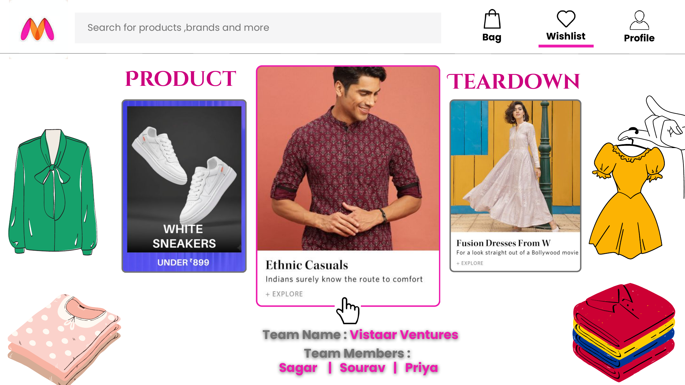

| | |
|---|---|
| **Team** | **Vistaar Ventures** |
| **Team Members** | Sagar · Sourav · Priya |
| **Subject** | Myntra (fashion e-commerce, India) |
| **Core Recommendation** | 24-Hour Price Lock + Transparent All-Inclusive Pricing ("Price Confidence Experience" MVP) |
| **North Star Metric** | Gross Merchandise Value (GMV) per Active User |
| **Original Deck** | [`original/Myntra_Product_Teardown.pdf`](original/Myntra_Product_Teardown.pdf) |

> **Note on sourcing:** Everything in this README is drawn only from the team's source PDF. Where the PDF does not state something, it is marked *Not specified in the source PDF.*

---

## Table of Contents

1. [Executive Summary](#1-executive-summary)
2. [Problem Statement](#2-problem-statement)
3. [Myntra Company Overview](#3-myntra-company-overview)
4. [Existing Product & Feature Analysis](#4-existing-product--feature-analysis)
5. [User Research (Primary)](#5-user-research-primary)
6. [Secondary Research](#6-secondary-research)
7. [Competitive Analysis](#7-competitive-analysis)
8. [User Personas](#8-user-personas)
9. [User Journey](#9-user-journey)
10. [Feature Suggestions](#10-feature-suggestions)
11. [Recommended Product Changes](#11-recommended-product-changes)
12. [Recommended MVP](#12-recommended-mvp)
13. [North Star Metric & KPIs](#13-north-star-metric--kpis)
14. [Expected Impact](#14-expected-impact)
15. [Guesstimate / Business Impact Calculation](#15-guesstimate--business-impact-calculation)
16. [PRD / MVP Specification](#16-prd--mvp-specification)
17. [Prototype Flow](#17-prototype-flow)
18. [Tech Stack](#18-tech-stack)
19. [Project Structure](#19-project-structure)
20. [Sources](#20-sources)
21. [Conclusion](#21-conclusion)
22. [Appendix: All 28 Slides](#22-appendix-all-28-slides)

---

## 1. Executive Summary

This teardown analyzes Myntra's shopping journey, from app launch to returns, with one focus: **why users who browse and wishlist items never complete a first purchase.**

The work combines company and feature analysis, a primary survey (n = 50), secondary research (Reddit and App Store signals), competitor benchmarking, three personas and a 10-step journey audit. Findings point to **price uncertainty and hidden fees** as the main friction at the wishlist-to-checkout stage, with return penalties and refund-method concerns as secondary trust barriers.

The team recommends an MVP that combines two ideas:

- **24-Hour Price Lock:** wishlisting an item freezes its discounted price for 24 hours.
- **Transparent All-Inclusive Pricing:** platform and delivery fees are shown on the product page, not for the first time at checkout.

Under the team's guesstimate model, this lifts first-purchase activation from **5.00% to 7.00%**, wishlist-to-cart graduation from **12.00% to 15.00%**, and the North Star Metric (Net GMV per Active User) from **₹58.46 to ₹74.59 (+₹16.13 per user)**, with the return-to-order ratio unchanged at 30%.

A working UX prototype (web and app versions) demonstrates the flow.

## 2. Problem Statement

> **"How might we convert browse-and-wishlist users into first-time buyers by reducing checkout friction?"**

Supporting framing from the PRD:

- Many users use the wishlist to save items while waiting for deeper discounts.
- On returning to buy, they hit **two friction points**: **unexpected price increases** and **hidden checkout fees**.
- The result is **lost trust and high abandonment rates**.

---

## 3. Myntra Company Overview

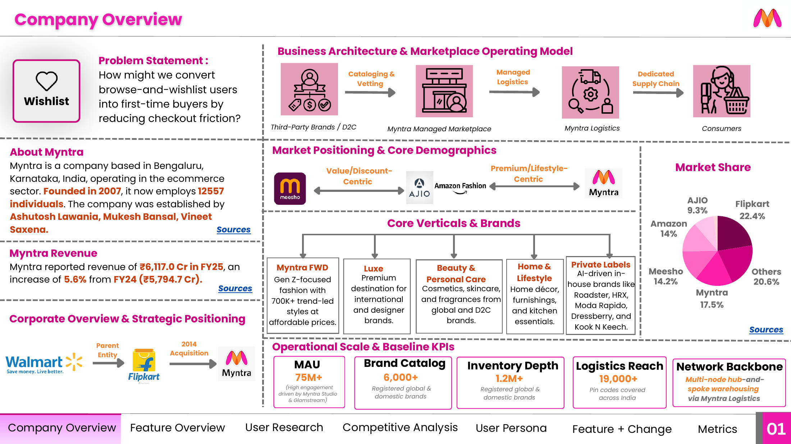

### Background

| Attribute | Detail |
|---|---|
| **Headquarters** | Bengaluru, Karnataka, India |
| **Sector** | E-commerce |
| **Founded** | 2007 |
| **Founders** | Ashutosh Lawania, Mukesh Bansal, Vineet Saxena |
| **Employees** | 12,557 |
| **Corporate lineage** | Walmart (parent entity) → Flipkart → Myntra (acquired 2014) |
| **Revenue** | ₹6,117.0 Cr in FY25, up **5.6%** from ₹5,794.7 Cr in FY24 |

### Business Model / Marketplace Operating Model

Myntra operates a **managed marketplace**:

`Third-Party Brands / D2C` → *(cataloging & vetting)* → `Myntra Managed Marketplace` → *(managed logistics)* → `Myntra Logistics` → *(dedicated supply chain)* → `Consumers`

### Market Positioning

- **Value / discount-centric:** Meesho, AJIO.
- **Premium / lifestyle-centric:** Amazon Fashion, Myntra.

**Market share (as shown in the PDF):**

| Player | Share |
|---|---|
| Flipkart | 22.4% |
| Others | 20.6% |
| **Myntra** | **17.5%** |
| Meesho | 14.2% |
| Amazon | 14.0% |
| AJIO | 9.3% |

> Source and year of the market-share data: *Not specified in the source PDF* (the slide links to a "Sources" appendix, which lists no market-share-specific source).

### Core Verticals & Brands

| Vertical | Description |
|---|---|
| **Myntra FWD** | Gen Z-focused fashion with 700K+ trend-led styles at affordable prices |
| **Luxe** | Premium destination for international and designer brands |
| **Beauty & Personal Care** | Cosmetics, skincare and fragrances from global and D2C brands |
| **Home & Lifestyle** | Home décor, furnishings and kitchen essentials |
| **Private Labels** | AI-driven in-house brands such as Roadster, HRX, Moda Rapido, Dressberry and Kook N Keech |

### Operational Scale & Baseline KPIs

| KPI | Value | Note (as in PDF) |
|---|---|---|
| **Monthly Active Users (MAU)** | **75M+** | High engagement driven by Myntra Studio & Glamstream |
| **Brand Catalog** | **6,000+** | Registered global & domestic brands |
| **Inventory Depth** | **1.2M+** | Labeled "Registered global & domestic brands" in the PDF (same label as Brand Catalog; the unit appears to be a labeling error — *unit not clarified in the source PDF*) |
| **Logistics Reach** | **19,000+** | Pin codes covered across India |
| **Network Backbone** | Multi-node hub-and-spoke warehousing | Via Myntra Logistics |

---

## 4. Existing Product & Feature Analysis

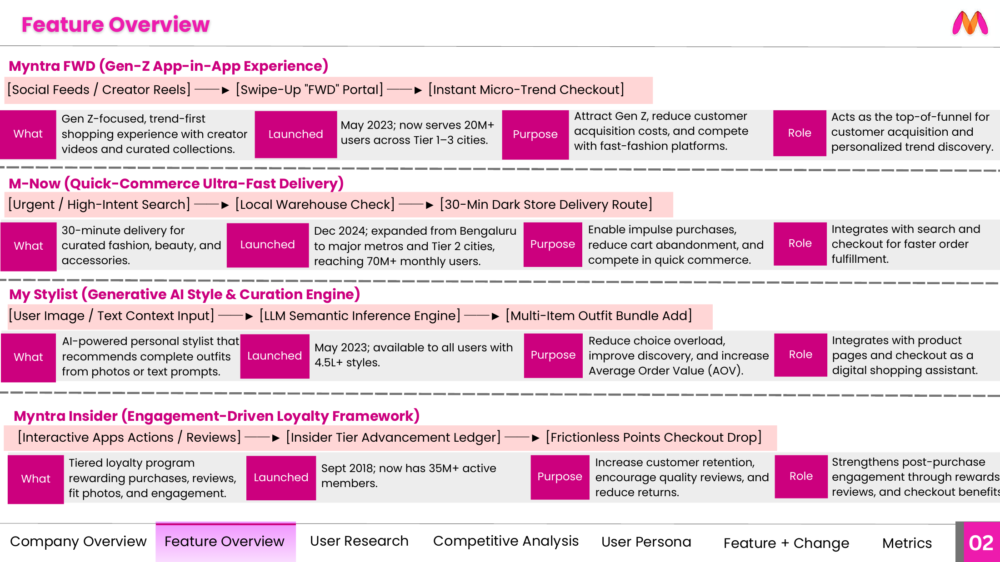

| Feature | What it is | Launched | Purpose | Role in the user journey |
|---|---|---|---|---|
| **Myntra FWD** (Gen-Z app-in-app experience) | Gen Z-focused, trend-first shopping with creator videos and curated collections | May 2023; now serves **20M+** users across Tier 1–3 cities | Attract Gen Z, reduce customer acquisition cost, compete with fast-fashion platforms | **Top of funnel:** customer acquisition and personalized trend discovery |
| **M-Now** (quick-commerce delivery) | 30-minute delivery for curated fashion, beauty and accessories | Dec 2024; expanded from Bengaluru to major metros and Tier 2 cities, reaching **70M+** monthly users | Enable impulse purchases, reduce cart abandonment, compete in quick commerce | Integrates with search and checkout for faster fulfillment |
| **My Stylist** (generative AI style & curation) | AI personal stylist recommending complete outfits from photos or text prompts | May 2023; available to all users with **4.5L+** styles | Reduce choice overload, improve discovery, increase Average Order Value (AOV) | Digital shopping assistant across product pages and checkout |
| **Myntra Insider** (loyalty framework) | Tiered loyalty program rewarding purchases, reviews, fit photos and engagement | Sept 2018; now **35M+** active members | Increase retention, encourage quality reviews, reduce returns | Strengthens post-purchase engagement via rewards, reviews and checkout benefits |

**Flow of each feature (from the PDF):**

- **Myntra FWD:** Social Feeds / Creator Reels → Swipe-Up "FWD" Portal → Instant Micro-Trend Checkout
- **M-Now:** Urgent / High-Intent Search → Local Warehouse Check → 30-Min Dark Store Delivery Route
- **My Stylist:** User Image / Text Context Input → LLM Semantic Inference Engine → Multi-Item Outfit Bundle Add
- **Myntra Insider:** Interactive App Actions / Reviews → Insider Tier Advancement Ledger → Frictionless Points Checkout Drop

---

## 5. User Research (Primary)

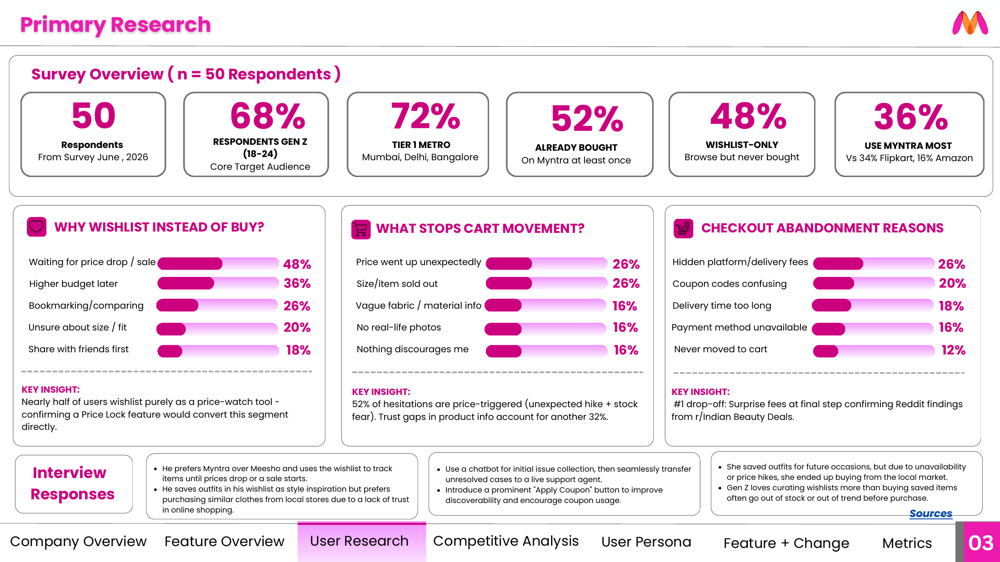

### Survey Overview

| Parameter | Result |
|---|---|
| **Sample size** | **50 respondents** (survey run in June 2026) |
| **Gen Z (18–24)** | **68%** — core target audience |
| **Tier 1 metro** (Mumbai, Delhi, Bangalore) | **72%** |
| **Already bought on Myntra at least once** | **52%** |
| **Wishlist-only** (browse but never bought) | **48%** |
| **Use Myntra most** | **36%** (vs 34% Flipkart, 16% Amazon) |

Full response sheet: see [Sources](#20-sources).

### Wishlist Behavior — "Why wishlist instead of buy?"

| Reason | % |
|---|---|
| Waiting for price drop / sale | **48%** |
| Higher budget later | 36% |
| Bookmarking / comparing | 26% |
| Unsure about size / fit | 20% |
| Share with friends first | 18% |

**Key insight:** Nearly half of users wishlist purely as a price-watch tool, so a **Price Lock** feature would convert this segment directly.

### Cart Movement Barriers — "What stops cart movement?"

| Barrier | % |
|---|---|
| Price went up unexpectedly | 26% |
| Size / item sold out | 26% |
| Vague fabric / material info | 16% |
| No real-life photos | 16% |
| Nothing discourages me | 16% |

**Key insight:** **52%** of hesitations are price-triggered (unexpected hike + stock fear). Trust gaps in product info account for another **32%**.

### Checkout Abandonment Reasons

| Reason | % |
|---|---|
| Hidden platform / delivery fees | **26%** |
| Coupon codes confusing | 20% |
| Delivery time too long | 18% |
| Payment method unavailable | 16% |
| Never moved to cart | 12% |

**Key insight:** The **#1 drop-off is surprise fees at the final step**, which confirms Reddit findings from r/IndianBeautyDeals.

### Interview Responses

| # | Response |
|---|---|
| 1 | He prefers Myntra over Meesho and uses the wishlist to track items until prices drop or a sale starts. |
| 2 | He saves outfits in his wishlist as style inspiration but prefers buying similar clothes from local stores because of a lack of trust in online shopping. |
| 3 | Suggestion: use a chatbot for initial issue collection, then seamlessly hand unresolved cases to a live support agent. |
| 4 | Suggestion: introduce a prominent "Apply Coupon" button to improve discoverability and encourage coupon usage. |
| 5 | She saved outfits for future occasions, but because of unavailability or price hikes she ended up buying from the local market. |
| 6 | Gen Z loves curating wishlists more than buying; saved items often go out of stock or out of trend before purchase. |

---

## 6. Secondary Research

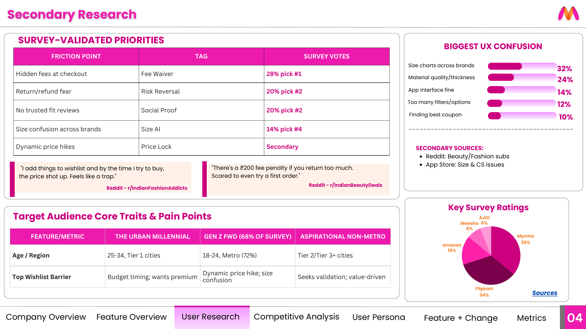

### Survey-Validated Priorities (Major Friction Points)

| Friction point | Tag | Survey votes |
|---|---|---|
| Hidden fees at checkout | Fee Waiver | **28% pick #1** |
| Return / refund fear | Risk Reversal | 20% pick #2 |
| No trusted fit reviews | Social Proof | 20% pick #2 |
| Size confusion across brands | Size AI | 14% pick #4 |
| Dynamic price hikes | Price Lock | Secondary |

### Biggest UX Confusion

| Area | % |
|---|---|
| Size charts across brands | **32%** |
| Material quality / thickness | 24% |
| App interface fine | 14% |
| Too many filters / options | 12% |
| Finding best coupon | 10% |

### Key Survey Ratings (platform share)

Myntra **36%** · Flipkart **34%** · Amazon **16%** · Meesho **8%** · AJIO **6%**

### Reddit & App Store Insights

- **Secondary sources used:** Reddit beauty/fashion subreddits; App Store reviews on size and customer-service issues.
- *"I add things to wishlist and by the time I try to buy, the price shot up. Feels like a trap."* — r/IndianFashionAddicts
- *"There's a ₹200 fee penalty if you return too much. Scared to even try a first order."* — r/IndianBeautyDeals

### Target Audience Core Traits & Pain Points

| Feature / Metric | The Urban Millennial | Gen Z FWD (68% of survey) | Aspirational Non-Metro |
|---|---|---|---|
| **Age / Region** | 25–34, Tier 1 cities | 18–24, Metro (72%) | Tier 2 / Tier 3+ cities |
| **Top wishlist barrier** | Budget timing; wants premium | Dynamic price hike; size confusion | Seeks validation; value-driven |

---

## 7. Competitive Analysis

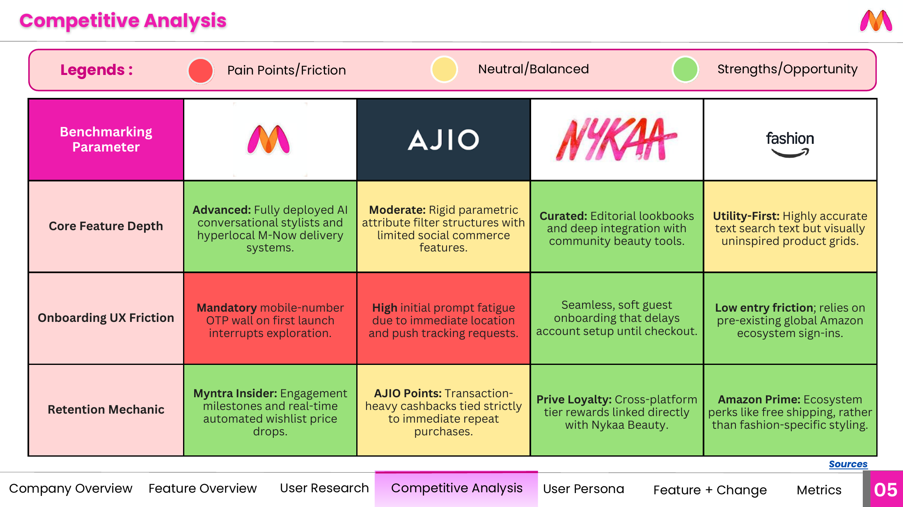

Legend (from the PDF): 🔴 Pain point / friction · 🟡 Neutral / balanced · 🟢 Strength / opportunity

### Benchmark Summary

| Parameter | Myntra | AJIO | Nykaa | Amazon Fashion |
|---|---|---|---|---|
| **Core feature depth** | 🟢 **Advanced:** fully deployed AI conversational stylists and hyperlocal M-Now delivery | 🟡 **Moderate:** rigid parametric attribute filters, limited social commerce | 🟢 **Curated:** editorial lookbooks, deep integration with community beauty tools | 🟡 **Utility-first:** highly accurate text search, visually uninspired product grids |
| **Onboarding UX friction** | 🔴 **Mandatory** mobile-number OTP wall on first launch interrupts exploration | 🔴 **High** initial prompt fatigue (immediate location and push-tracking requests) | 🟢 Seamless, soft guest onboarding that delays account setup until checkout | 🟢 **Low** entry friction; relies on existing Amazon ecosystem sign-ins |
| **Retention mechanic** | 🟢 **Myntra Insider:** engagement milestones and real-time automated wishlist price drops | 🟡 **AJIO Points:** transaction-heavy cashbacks tied to immediate repeat purchases | 🟢 **Prive Loyalty:** cross-platform tier rewards linked with Nykaa Beauty | 🟢 **Amazon Prime:** ecosystem perks such as free shipping, not fashion-specific styling |

### Detailed Comparison

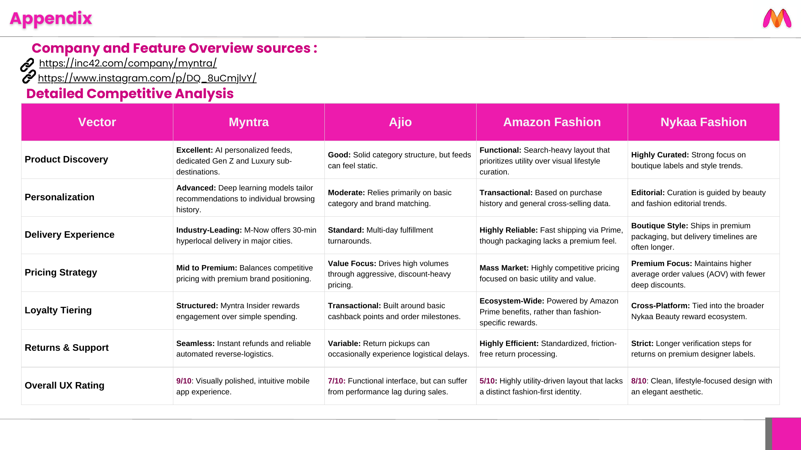

| Vector | Myntra | Ajio | Amazon Fashion | Nykaa Fashion |
|---|---|---|---|---|
| **Product discovery** | **Excellent:** AI personalized feeds, dedicated Gen Z and Luxury sub-destinations | **Good:** solid category structure, but feeds can feel static | **Functional:** search-heavy layout prioritizing utility over visual lifestyle curation | **Highly curated:** strong focus on boutique labels and style trends |
| **Personalization** | **Advanced:** deep learning models tailor recommendations to individual browsing history | **Moderate:** relies on basic category and brand matching | **Transactional:** based on purchase history and general cross-selling data | **Editorial:** curation guided by beauty and fashion editorial trends |
| **Delivery experience** | **Industry-leading:** M-Now offers 30-min hyperlocal delivery in major cities | **Standard:** multi-day fulfillment turnarounds | **Highly reliable:** fast shipping via Prime, though packaging lacks a premium feel | **Boutique style:** premium packaging, but delivery timelines are often longer |
| **Pricing strategy** | **Mid to premium:** balances competitive pricing with premium brand positioning | **Value focus:** high volumes through aggressive, discount-heavy pricing | **Mass market:** highly competitive pricing focused on utility and value | **Premium focus:** higher AOV with fewer deep discounts |
| **Loyalty tiering** | **Structured:** Myntra Insider rewards engagement over simple spending | **Transactional:** basic cashback points and order milestones | **Ecosystem-wide:** Amazon Prime benefits, not fashion-specific rewards | **Cross-platform:** tied into the broader Nykaa Beauty reward ecosystem |
| **Returns & support** | **Seamless:** instant refunds and reliable automated reverse logistics | **Variable:** return pickups can occasionally face logistical delays | **Highly efficient:** standardized, friction-free return processing | **Strict:** longer verification steps for returns on premium designer labels |
| **Overall UX rating** | **9/10** — visually polished, intuitive mobile app | **7/10** — functional, but can lag during sales | **5/10** — utility-driven, lacks a distinct fashion-first identity | **8/10** — clean, lifestyle-focused design with an elegant aesthetic |

---

## 8. User Personas

### Persona 1 — Ananya Sharma: *The cautious budget shopper frustrated by hidden checkout fees*

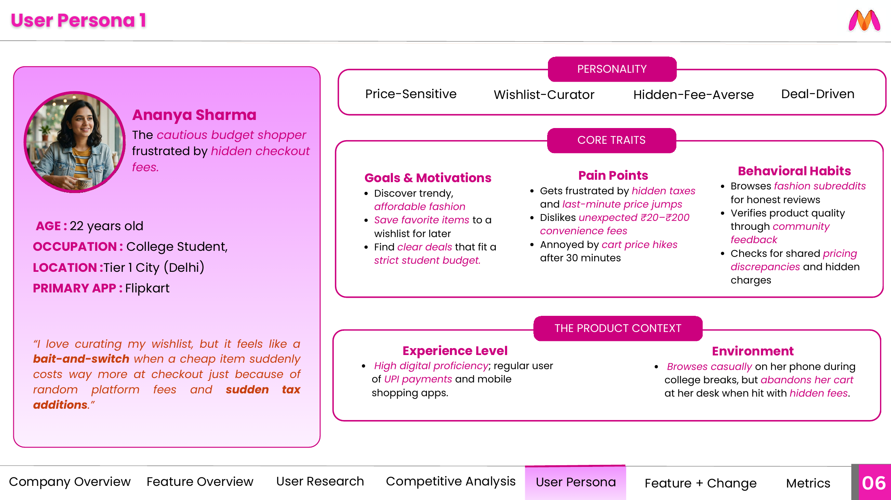

| | |
|---|---|
| **Age** | 22 |
| **Occupation** | College student |
| **Location** | Tier 1 city (Delhi) |
| **Primary app** | Flipkart |
| **Personality** | Price-sensitive · Wishlist-curator · Hidden-fee-averse · Deal-driven |

- **Goals & motivations:** discover trendy, affordable fashion; save favorite items to a wishlist for later; find clear deals that fit a strict student budget.
- **Pain points:** frustrated by hidden taxes and last-minute price jumps; dislikes unexpected ₹20–₹200 convenience fees; annoyed by cart price hikes after 30 minutes.
- **Behavioral habits:** browses fashion subreddits for honest reviews; verifies product quality through community feedback; checks for shared pricing discrepancies and hidden charges.
- **Product context:** *Experience level:* high digital proficiency, regular user of UPI payments and mobile shopping apps. *Environment:* browses casually on her phone during college breaks, but abandons her cart at her desk when hit with hidden fees.
- **Quote:** *"I love curating my wishlist, but it feels like a bait-and-switch when a cheap item suddenly costs way more at checkout just because of random platform fees and sudden tax additions."*

### Persona 2 — Rahul Verma: *The cautious first-time apparel buyer intimidated by rigid return penalties*

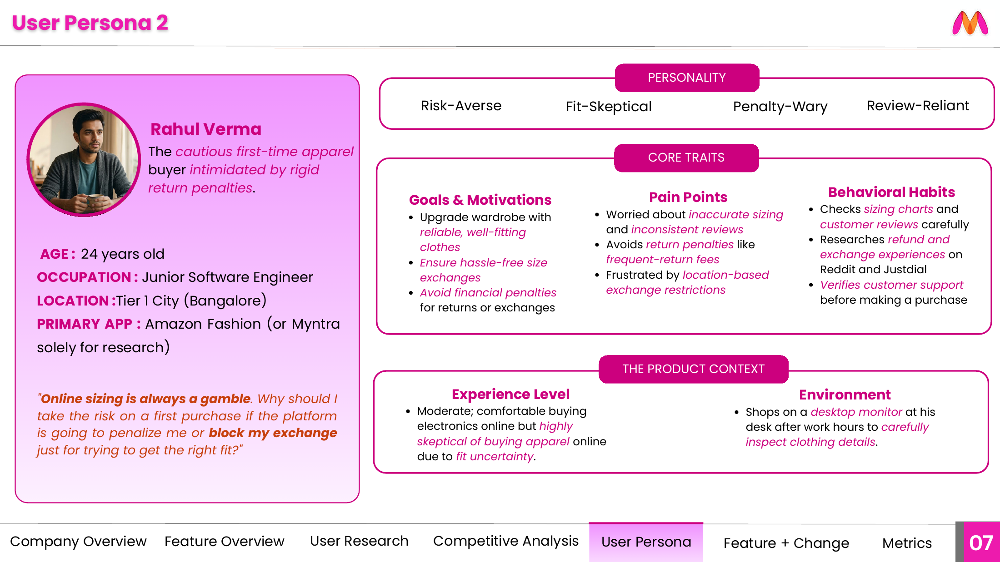

| | |
|---|---|
| **Age** | 24 |
| **Occupation** | Junior software engineer |
| **Location** | Tier 1 city (Bangalore) |
| **Primary app** | Amazon Fashion (or Myntra solely for research) |
| **Personality** | Risk-averse · Fit-skeptical · Penalty-wary · Review-reliant |

- **Goals & motivations:** upgrade wardrobe with reliable, well-fitting clothes; ensure hassle-free size exchanges; avoid financial penalties for returns or exchanges.
- **Pain points:** worried about inaccurate sizing and inconsistent reviews; avoids return penalties such as frequent-return fees; frustrated by location-based exchange restrictions.
- **Behavioral habits:** checks size charts and customer reviews carefully; researches refund and exchange experiences on Reddit and Justdial; verifies customer support before purchasing.
- **Product context:** *Experience level:* moderate; comfortable buying electronics online but highly skeptical of buying apparel online due to fit uncertainty. *Environment:* shops on a desktop monitor at his desk after work hours to inspect clothing details.
- **Quote:** *"Online sizing is always a gamble. Why should I take the risk on a first purchase if the platform is going to penalize me or block my exchange just for trying to get the right fit?"*

### Persona 3 — Priya Patel: *The risk-averse browser who abandons her wishlist due to payment and platform uncertainties*

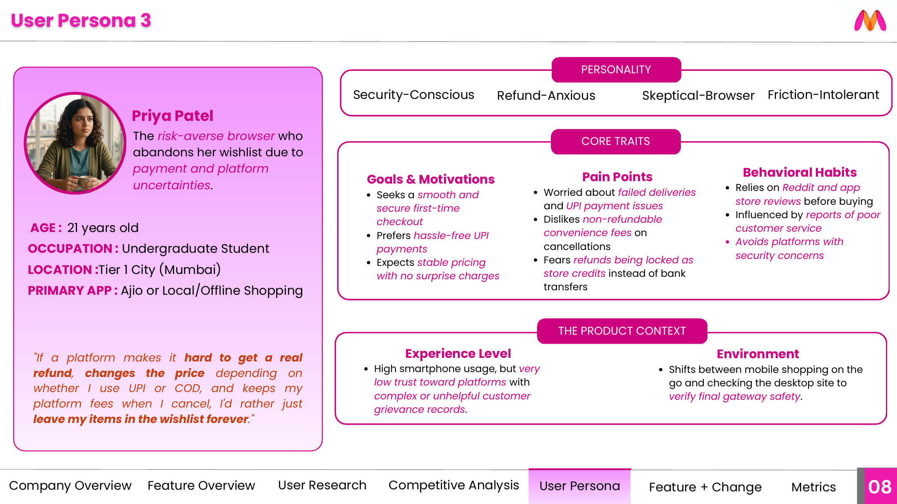

| | |
|---|---|
| **Age** | 21 |
| **Occupation** | Undergraduate student |
| **Location** | Tier 1 city (Mumbai) |
| **Primary app** | Ajio or local / offline shopping |
| **Personality** | Security-conscious · Refund-anxious · Skeptical-browser · Friction-intolerant |

- **Goals & motivations:** seeks a smooth and secure first-time checkout; prefers hassle-free UPI payments; expects stable pricing with no surprise charges.
- **Pain points:** worried about failed deliveries and UPI payment issues; dislikes non-refundable convenience fees on cancellations; fears refunds being locked as store credits instead of bank transfers.
- **Behavioral habits:** relies on Reddit and app-store reviews before buying; influenced by reports of poor customer service; avoids platforms with security concerns.
- **Product context:** *Experience level:* high smartphone usage, but very low trust toward platforms with complex or unhelpful grievance records. *Environment:* shifts between mobile shopping on the go and checking the desktop site to verify final gateway safety.
- **Quote:** *"If a platform makes it hard to get a real refund, changes the price depending on whether I use UPI or COD, and keeps my platform fees when I cancel, I'd rather just leave my items in the wishlist forever."*

---

## 9. User Journey

The team audited the Myntra app across 10 steps. Screenshots are in the images below.

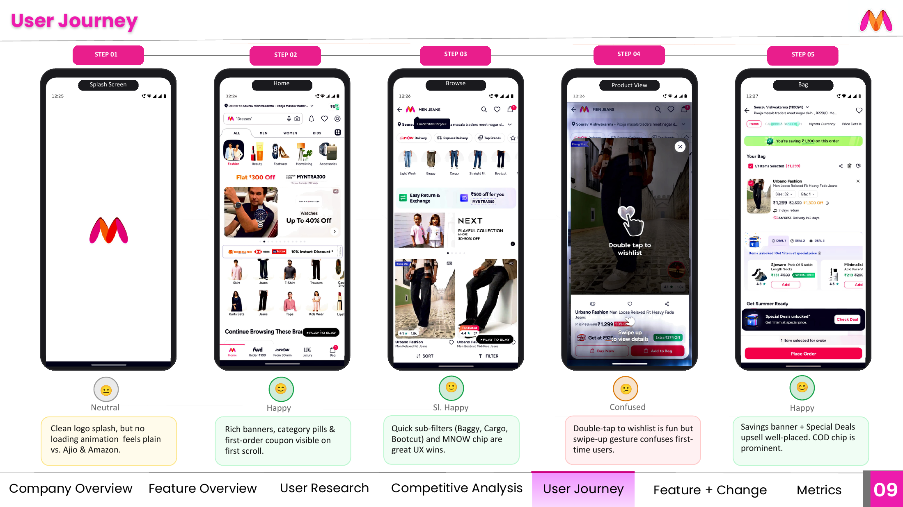

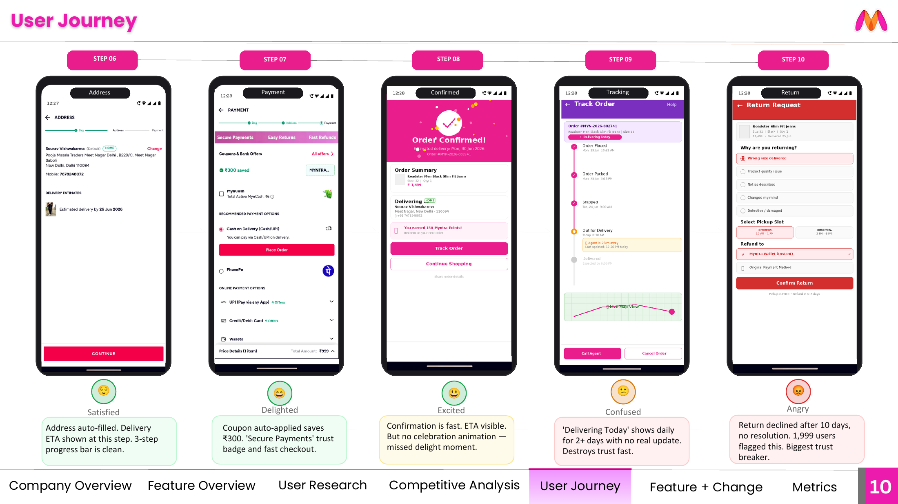

> The PDF labels each step by screen name and does not list a separate "user action" column. The action below is inferred from the screen label; emotions and insights are quoted from the PDF.

| Step | Screen | User action | Emotion | Observed issue / UX insight |
|---|---|---|---|---|
| 01 | Splash Screen | Launches the app | 😐 Neutral | Clean logo splash, but no loading animation feels plain vs. Ajio & Amazon |
| 02 | Home | Lands on home feed and scrolls | 😊 Happy | Rich banners, category pills and first-order coupon visible on first scroll |
| 03 | Browse | Browses a category (Men Jeans) and filters | 🙂 Slightly happy | Quick sub-filters (Baggy, Cargo, Bootcut) and M-Now chip are great UX wins |
| 04 | Product View | Views a product; double-tap to wishlist / swipe up for details | 😕 Confused | Double-tap to wishlist is fun, but the swipe-up gesture confuses first-time users |
| 05 | Bag | Reviews bag and savings | 😊 Happy | Savings banner and Special Deals upsell well-placed; COD chip is prominent |
| 06 | Address | Confirms delivery address | 😌 Satisfied | Address auto-filled; delivery ETA shown at this step; 3-step progress bar is clean |
| 07 | Payment | Selects payment method | 😄 Delighted | Coupon auto-applied saves ₹300; "Secure Payments" trust badge and fast checkout |
| 08 | Confirmed | Sees order confirmation | 😃 Excited | Confirmation is fast and ETA is visible, but no celebration animation (missed delight moment) |
| 09 | Tracking | Tracks the order | 😕 Confused | "Delivering Today" shows daily for 2+ days with no real update; destroys trust fast |
| 10 | Return | Requests a return | 😡 Angry | Return declined after 10 days with no resolution; **1,999 users flagged this**; biggest trust breaker |

---

## 10. Feature Suggestions

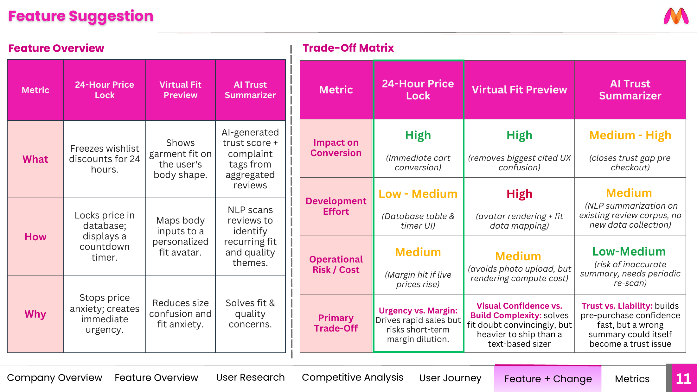

### 10.1 24-Hour Price Lock *(selected — highlighted in the trade-off matrix)*

- **What it does:** freezes wishlist discounts for 24 hours.
- **How it works:** locks the price in the database and displays a countdown timer.
- **Why:** stops price anxiety and creates immediate urgency.
- **Expected impact:** **High** conversion impact (immediate cart conversion).
- **Development effort:** **Low–Medium** (database table and timer UI).
- **Operational risk / cost:** **Medium** (margin hit if live prices rise).
- **Main trade-off:** *Urgency vs. Margin* — drives rapid sales but risks short-term margin dilution.

### 10.2 Virtual Fit Preview

- **What it does:** shows garment fit on the user's body shape.
- **How it works:** maps body inputs to a personalized fit avatar.
- **Why:** reduces size confusion and fit anxiety.
- **Expected impact:** **High** (removes the biggest cited UX confusion).
- **Development effort:** **High** (avatar rendering + fit data mapping).
- **Operational risk / cost:** **Medium** (avoids photo upload, but rendering compute cost).
- **Main trade-off:** *Visual Confidence vs. Build Complexity* — solves fit doubt convincingly, but is heavier to ship than a text-based sizer.

### 10.3 AI Trust Summarizer

- **What it does:** AI-generated trust score and complaint tags from aggregated reviews.
- **How it works:** NLP scans reviews to identify recurring fit and quality themes.
- **Why:** addresses fit and quality concerns.
- **Expected impact:** **Medium–High** (closes the trust gap pre-checkout).
- **Development effort:** **Medium** (NLP summarization on the existing review corpus, no new data collection).
- **Operational risk / cost:** **Low–Medium** (risk of an inaccurate summary; needs periodic re-scan).
- **Main trade-off:** *Trust vs. Liability* — builds pre-purchase confidence fast, but a wrong summary could itself become a trust issue.

### Trade-Off Matrix

| Metric | **24-Hour Price Lock** | Virtual Fit Preview | AI Trust Summarizer |
|---|---|---|---|
| **Impact on conversion** | **High** | High | Medium–High |
| **Development effort** | **Low–Medium** | High | Medium |
| **Operational risk / cost** | **Medium** | Medium | Low–Medium |
| **Primary trade-off** | Urgency vs. Margin | Visual Confidence vs. Build Complexity | Trust vs. Liability |

---

## 11. Recommended Product Changes

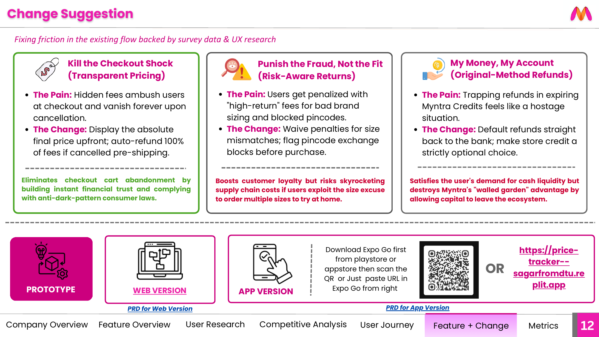

*Fixing friction in the existing flow, backed by survey data and UX research.*

### 11.1 Kill the Checkout Shock — Transparent Pricing

| | |
|---|---|
| **Existing pain** | Hidden fees ambush users at checkout and vanish forever upon cancellation |
| **Proposed change** | Display the absolute final price upfront; auto-refund 100% of fees if cancelled pre-shipping |
| **Expected benefit** | Eliminates checkout cart abandonment by building instant financial trust and complying with anti-dark-pattern consumer laws |
| **Potential trade-off** | *Not specified in the source PDF.* |

### 11.2 Punish the Fraud, Not the Fit — Risk-Aware Returns

| | |
|---|---|
| **Existing pain** | Users are penalized with "high-return" fees for bad brand sizing and blocked pincodes |
| **Proposed change** | Waive penalties for size mismatches; flag pincode exchange blocks before purchase |
| **Expected benefit** | Boosts customer loyalty |
| **Potential trade-off** | Risks skyrocketing supply-chain costs if users exploit the size excuse to order multiple sizes to try at home |

### 11.3 My Money, My Account — Original-Method Refunds

| | |
|---|---|
| **Existing pain** | Trapping refunds in expiring Myntra Credits feels like a hostage situation |
| **Proposed change** | Default refunds straight back to the bank; make store credit a strictly optional choice |
| **Expected benefit** | Satisfies the user's demand for cash liquidity |
| **Potential trade-off** | Destroys Myntra's "walled garden" advantage by allowing capital to leave the ecosystem |

---

## 12. Recommended MVP

**Selected MVP: "Price Confidence Experience (MVP)"** — the **24-Hour Price Lock** feature combined with the **Transparent All-Inclusive Pricing** UX change.

> The PDF does not include an explicit "why we prioritized this" statement. The rationale below is assembled from evidence stated elsewhere in the PDF.

**Why it was prioritized:**

- **Evidence of demand:** **48%** of respondents wishlist while waiting for a price drop; unexpected price hikes (26%) and hidden fees (26%) lead cart-movement and checkout-abandonment barriers; **28%** ranked hidden fees as their #1 friction.
- **Trade-off profile:** Price Lock is the only feature highlighted in the matrix: **High** conversion impact with **Low–Medium** development effort (vs. High effort for Virtual Fit Preview).
- **Persona fit:** directly addresses Ananya's pain points (hidden fees, price jumps) and Priya's expectation of stable pricing.
- **Buildable as a prototype:** a single-product, local-state simulation that needs no backend.
- **Modeled upside:** the largest quantified lift in the team's guesstimate (see [Section 15](#15-guesstimate--business-impact-calculation)).

**Prototype links:**

| Version | Link |
|---|---|
| Web version | <https://attached-assets--sourav23248.replit.app/> |
| App version | <https://price-tracker--sagarfromdtu.replit.app/> (the slide also gives an Expo Go instruction: install Expo Go, then scan the QR code or paste the URL into Expo Go) |

---

## 13. North Star Metric & KPIs

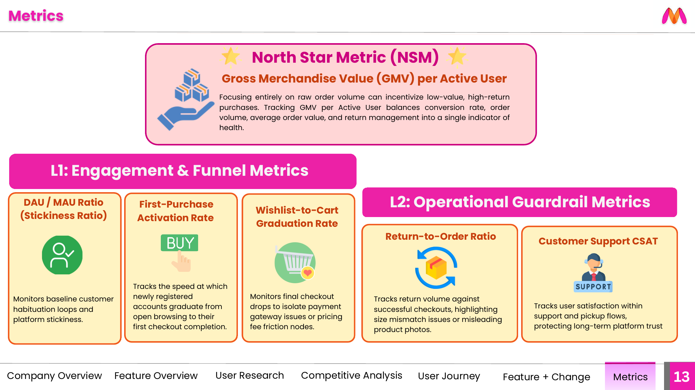

### North Star Metric (NSM): **Gross Merchandise Value (GMV) per Active User**

Focusing only on raw order volume can incentivize low-value, high-return purchases. GMV per Active User balances **conversion rate, order volume, average order value and return management** into a single indicator of health. (The performance table later reports it as **Net GMV per Active User**.)

### L1 — Engagement & Funnel Metrics

| Metric | What it measures |
|---|---|
| **DAU / MAU ratio** (stickiness ratio) | Baseline customer habituation loops and platform stickiness |
| **First-Purchase Activation Rate** | Speed at which newly registered accounts graduate from open browsing to their first checkout completion |
| **Wishlist-to-Cart Graduation Rate** | Final checkout drops, to isolate payment-gateway issues or pricing/fee friction nodes |

### L2 — Operational Guardrail Metrics

| Metric | What it measures |
|---|---|
| **Return-to-Order Ratio** | Return volume against successful checkouts, highlighting size-mismatch issues or misleading product photos |
| **Customer Support CSAT** | User satisfaction within support and pickup flows, protecting long-term platform trust |

---

## 14. Expected Impact

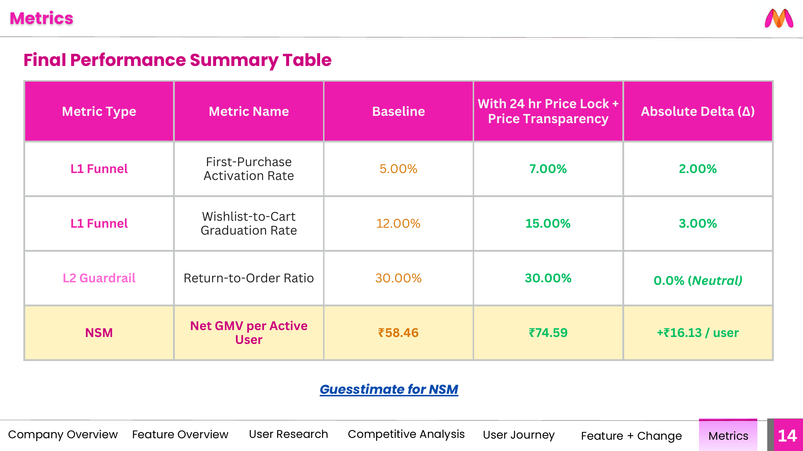

| Metric type | Metric | Baseline | With 24-hr Price Lock + Price Transparency | Absolute delta (Δ) |
|---|---|---|---|---|
| L1 Funnel | First-Purchase Activation Rate | 5.00% | **7.00%** | **+2.00%** |
| L1 Funnel | Wishlist-to-Cart Graduation Rate | 12.00% | **15.00%** | **+3.00%** |
| L2 Guardrail | Return-to-Order Ratio | 30.00% | **30.00%** | 0.0% (neutral) |
| **NSM** | **Net GMV per Active User** | **₹58.46** | **₹74.59** | **+₹16.13 / user** |

---

## 15. Guesstimate / Business Impact Calculation

### Part A — First-Purchase Activation

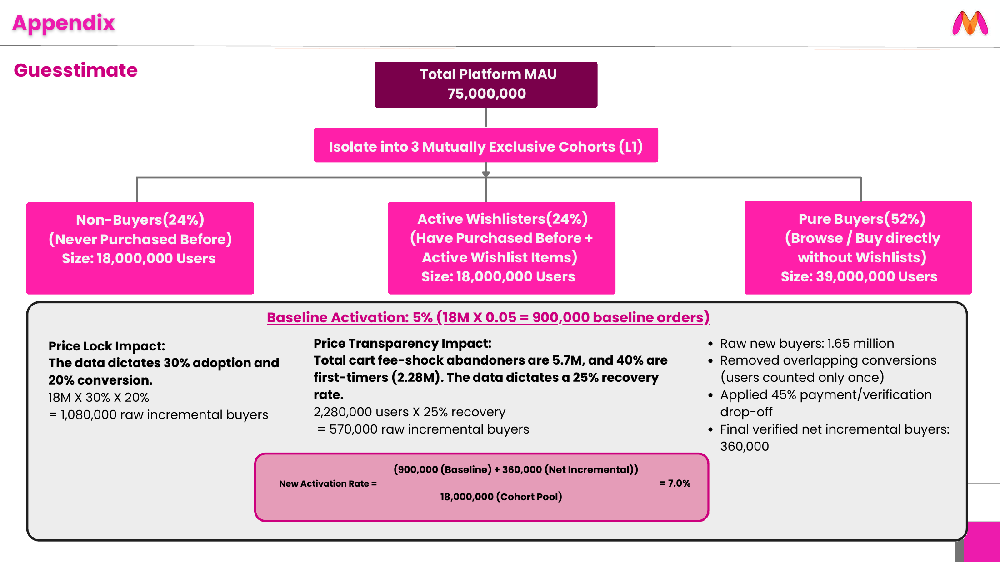

**Step 1 — User cohorts.** Total platform MAU = **75,000,000**, split into three mutually exclusive cohorts:

| Cohort | Share | Size | Definition |
|---|---|---|---|
| Non-Buyers | 24% | **18,000,000** | Never purchased before |
| Active Wishlisters | 24% | **18,000,000** | Have purchased before + active wishlist items |
| Pure Buyers | 52% | **39,000,000** | Browse / buy directly without wishlists |

**Step 2 — Baseline activation.** 5% → 18M × 0.05 = **900,000 baseline orders**.

**Step 3 — Price Lock impact.** The data indicates 30% adoption and 20% conversion:
18M × 30% × 20% = **1,080,000 raw incremental buyers**.

**Step 4 — Price Transparency impact.** Total cart fee-shock abandoners = **5.7M**, of which **40% are first-timers (2.28M)**. At a 25% recovery rate:
2,280,000 × 25% = **570,000 raw incremental buyers**.

**Step 5 — Overlap and drop-off adjustment.**

- Raw new buyers: **1.65 million** (1,080,000 + 570,000)
- Removed overlapping conversions (users counted only once)
- Applied **45% payment/verification drop-off**
- **Final verified net incremental buyers: 360,000**

> The PDF does not show the intermediate arithmetic (the overlap percentage for this step) between 1.65M and 360,000. *Not specified in the source PDF.*

**Step 6 — New activation rate.**

```
New Activation Rate = (900,000 baseline + 360,000 net incremental) / 18,000,000 cohort pool
                    = 7.0%
```

### Part B — Wishlist-to-Cart Graduation, GMV and NSM

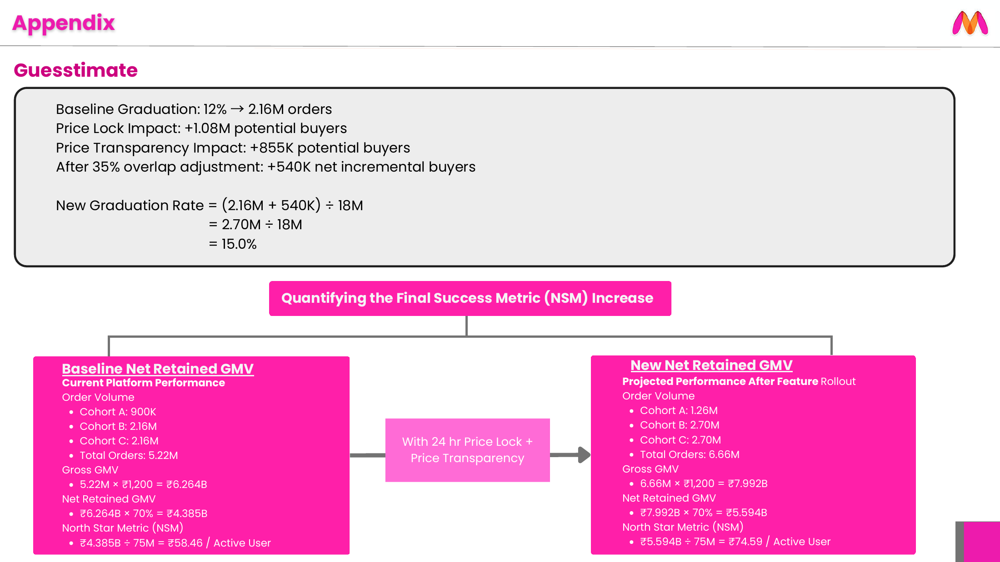

**Step 7 — Wishlist-to-cart graduation.**

- Baseline graduation: 12% → **2.16M orders**
- Price Lock impact: **+1.08M** potential buyers
- Price Transparency impact: **+855K** potential buyers
- After **35% overlap adjustment**: **+540K** net incremental buyers

```
New Graduation Rate = (2.16M + 540K) ÷ 18M
                    = 2.70M ÷ 18M
                    = 15.0%
```

> The PDF states the 35% overlap adjustment and the 540K result but does not show the arithmetic that links them. *Not specified in the source PDF.*

**Step 8 — Order volume, GMV and Net Retained GMV.**

| | Baseline (current platform) | After feature rollout (with 24 hr Price Lock + Price Transparency) |
|---|---|---|
| Cohort A orders | 900K | 1.26M |
| Cohort B orders | 2.16M | 2.70M |
| Cohort C orders | 2.16M | 2.70M |
| **Total orders** | **5.22M** | **6.66M** |
| **Gross GMV** (orders × ₹1,200) | 5.22M × ₹1,200 = **₹6.264B** | 6.66M × ₹1,200 = **₹7.992B** |
| **Net Retained GMV** (× 70%) | ₹6.264B × 70% = **₹4.385B** | ₹7.992B × 70% = **₹5.594B** |
| **NSM** (÷ 75M active users) | ₹4.385B ÷ 75M = **₹58.46 / active user** | ₹5.594B ÷ 75M = **₹74.59 / active user** |

**Final NSM change: ₹58.46 → ₹74.59 = +₹16.13 per active user.**

> The ₹1,200 per-order value and the 70% retention factor (consistent with a 30% return-to-order ratio) are used as shown; the PDF does not state their sources. The PDF also does not define Cohorts A, B and C explicitly.

---

## 16. PRD / MVP Specification

### 16.1 Overview

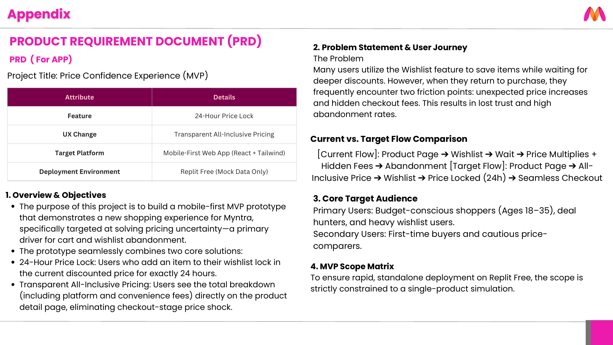

| Attribute | Details |
|---|---|
| **Project title** | **Price Confidence Experience (MVP)** |
| **Feature** | 24-Hour Price Lock |
| **UX change** | Transparent All-Inclusive Pricing |
| **Target platform** | Mobile-first web app (React + Tailwind) |
| **Deployment environment** | Replit Free (mock data only) |

**Problem.** Users wishlist items while waiting for deeper discounts, but on returning they meet unexpected price increases and hidden checkout fees, leading to lost trust and high abandonment.

**Objective.** Build a mobile-first MVP prototype demonstrating a new Myntra shopping experience that solves pricing uncertainty, a primary driver of cart and wishlist abandonment. It combines:

1. **24-Hour Price Lock:** adding an item to the wishlist locks the current discounted price for exactly 24 hours.
2. **Transparent All-Inclusive Pricing:** the total breakdown (including platform and convenience fees) is shown on the product detail page, eliminating checkout-stage price shock.

**Current vs. target flow.**

- **Current:** Product Page → Wishlist → Wait → Price Multiplies + Hidden Fees → Abandonment
- **Target:** Product Page → All-Inclusive Price → Wishlist → Price Locked (24h) → Seamless Checkout

**Target users.**

- **Primary:** budget-conscious shoppers (ages 18–35), deal hunters and heavy wishlist users.
- **Secondary:** first-time buyers and cautious price-comparers.

### 16.2 MVP Scope

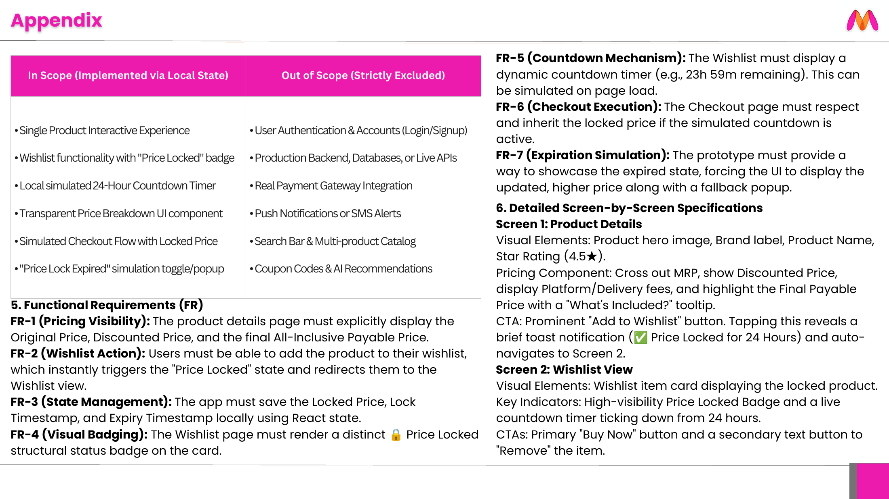

To enable rapid, standalone deployment on Replit Free, scope is strictly limited to a **single-product simulation**.

| In scope (implemented via local state) | Out of scope (strictly excluded) |
|---|---|
| Single-product interactive experience | User authentication & accounts (login/signup) |
| Wishlist with "Price Locked" badge | Production backend, databases or live APIs |
| Locally simulated 24-hour countdown timer | Real payment gateway integration |
| Transparent price breakdown UI component | Push notifications or SMS alerts |
| Simulated checkout flow with locked price | Search bar & multi-product catalog |
| "Price Lock Expired" simulation toggle / popup | Coupon codes & AI recommendations |

### 16.3 Functional Requirements

| ID | Requirement |
|---|---|
| **FR-1** Pricing Visibility | The product details page must display the Original Price, Discounted Price and final All-Inclusive Payable Price |
| **FR-2** Wishlist Action | Users can add the product to the wishlist, which instantly triggers the "Price Locked" state and redirects to the Wishlist view |
| **FR-3** State Management | Locked Price, Lock Timestamp and Expiry Timestamp are saved locally using React state |
| **FR-4** Visual Badging | The Wishlist card renders a distinct 🔒 Price Locked status badge |
| **FR-5** Countdown Mechanism | The Wishlist shows a dynamic countdown (e.g., 23h 59m remaining); may be simulated on page load |
| **FR-6** Checkout Execution | Checkout respects and inherits the locked price while the simulated countdown is active |
| **FR-7** Expiration Simulation | The prototype provides a way to show the expired state, with the updated higher price and a fallback popup |

### 16.4 Screen-by-Screen Specifications

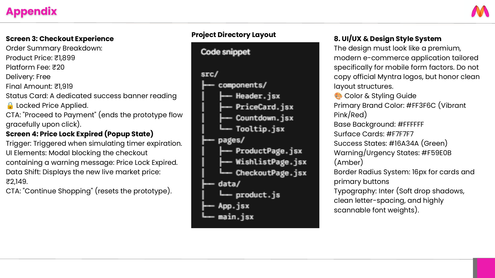

| Screen | Contents |
|---|---|
| **1. Product Details** | *Visual elements:* hero image, brand label, product name, star rating (4.5★). *Pricing:* crossed-out MRP, discounted price, platform/delivery fees, highlighted Final Payable Price with a "What's Included?" tooltip. *CTA:* prominent **Add to Wishlist**; tapping shows a toast (✅ Price Locked for 24 Hours) and auto-navigates to Screen 2 |
| **2. Wishlist View** | *Visual elements:* wishlist card showing the locked product. *Indicators:* high-visibility Price Locked badge and live countdown from 24 hours. *CTAs:* primary **Buy Now**; secondary text button **Remove** |
| **3. Checkout Experience** | *Order summary:* Product Price ₹1,899 + Platform Fee ₹20 + Delivery Free = **Final Amount ₹1,919**. *Status card:* success banner "🔒 Locked Price Applied". *CTA:* **Proceed to Payment** (ends the prototype flow gracefully) |
| **4. Price Lock Expired (popup)** | *Trigger:* simulating timer expiration. *UI:* modal blocking checkout with the warning "Price Lock Expired". *Data shift:* new live market price **₹2,149**. *CTA:* **Continue Shopping** (resets the prototype) |

### 16.5 UI/UX Requirements

- Must look like a **premium, modern e-commerce app** tailored for mobile form factors; do not copy official Myntra logos, but honor clean layout structures.

| Style token | Value |
|---|---|
| Primary brand color | `#FF3F6C` (vibrant pink/red) |
| Base background | `#FFFFFF` |
| Surface cards | `#F7F7F7` |
| Success states | `#16A34A` (green) |
| Warning / urgency states | `#F59E0B` (amber) |
| Border radius | 16px for cards and primary buttons |
| Typography | Inter (soft drop shadows, clean letter-spacing, highly scannable font weights) |

### 16.6 Implementation Roadmap

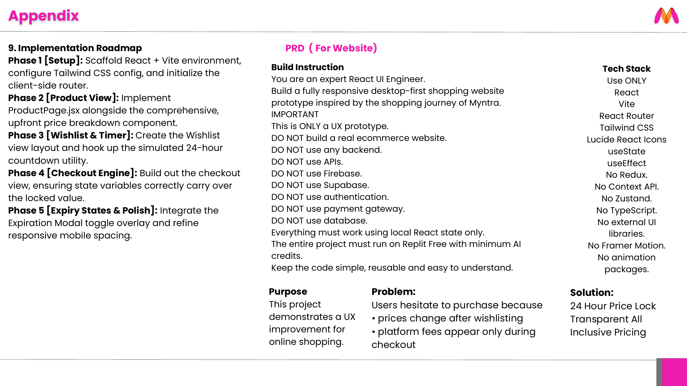

| Phase | Focus |
|---|---|
| **Phase 1 — Setup** | Scaffold React + Vite, configure Tailwind CSS, initialize the client-side router |
| **Phase 2 — Product View** | Implement `ProductPage.jsx` with the upfront price-breakdown component |
| **Phase 3 — Wishlist & Timer** | Build the Wishlist view and hook up the simulated 24-hour countdown utility |
| **Phase 4 — Checkout Engine** | Build the checkout view, carrying the locked value through state |
| **Phase 5 — Expiry States & Polish** | Integrate the Expiration Modal toggle overlay; refine responsive mobile spacing |

The PRD's final page also gives a finer **7-phase build sequence for Replit Free** (project setup/routing/folder structure/Tailwind/Header → Product Page → Wishlist → Countdown Logic → Checkout → Expired Popup → Responsive Polish), with the instruction to build incrementally, never regenerate previous files unless necessary, edit only files that need changes, and keep token usage minimal.

### 16.7 Included vs. Excluded Features

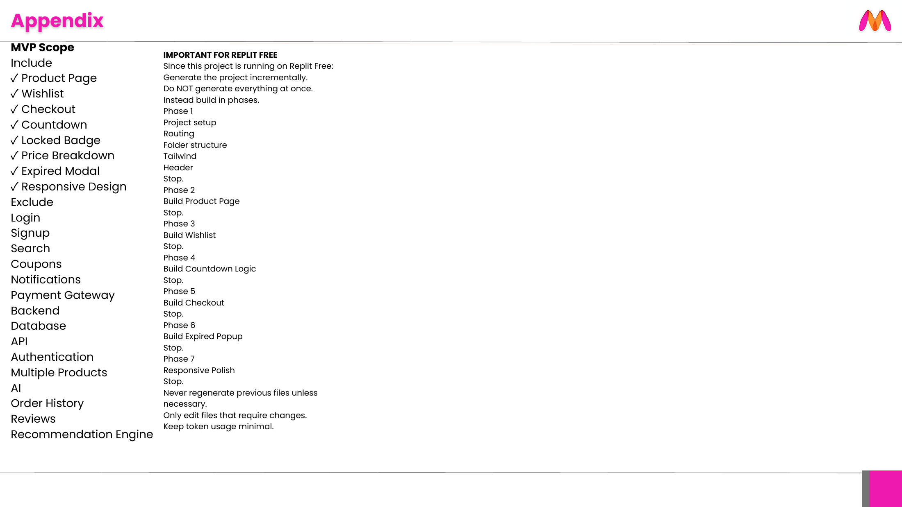

| Included | Excluded |
|---|---|
| Product Page | Login |
| Wishlist | Signup |
| Checkout | Search |
| Countdown | Coupons |
| Locked Badge | Notifications |
| Price Breakdown | Payment Gateway |
| Expired Modal | Backend |
| Responsive Design | Database |
| | API |
| | Authentication |
| | Multiple Products |
| | AI |
| | Order History |
| | Reviews |
| | Recommendation Engine |

### 16.8 Web-Version PRD (Desktop-First)

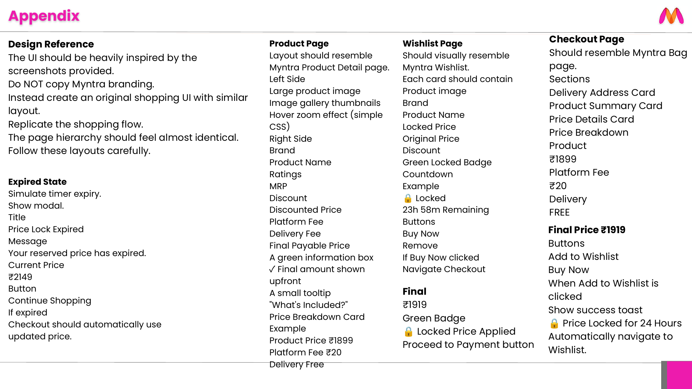

The appendix includes a second PRD for a **fully responsive, desktop-first website prototype** inspired by Myntra's shopping journey (the original is written as a build prompt for an AI/React engineer).

- **Purpose:** demonstrate a UX improvement for online shopping.
- **Problem:** users hesitate because prices change after wishlisting and platform fees appear only during checkout.
- **Solution:** 24 Hour Price Lock + Transparent All-Inclusive Pricing.
- **Design reference:** heavily inspired by supplied Myntra screenshots; create an original UI with a similar layout and near-identical page hierarchy. **Do not copy Myntra branding.**
- **Product page:** left side has a large product image, gallery thumbnails and a simple CSS hover zoom; right side shows brand, name, ratings, MRP, discount, discounted price, platform fee, delivery fee and final payable price, plus a green "Final amount shown upfront" box, a "What's Included?" tooltip and a price-breakdown card. Buttons: **Add to Wishlist** and **Buy Now**. Clicking Add to Wishlist shows the toast "🔒 Price Locked for 24 Hours" and navigates to the Wishlist.
- **Wishlist page:** each card shows image, brand, product name, locked price, original price, discount, green locked badge and countdown (e.g., "🔒 Locked · 23h 58m Remaining"); buttons **Buy Now** (to checkout) and **Remove**.
- **Checkout page:** resembles the Myntra Bag page with Delivery Address, Product Summary and Price Details cards. Product ₹1899, Platform Fee ₹20, Delivery FREE, **Final ₹1919**, green badge "🔒 Locked Price Applied", **Proceed to Payment** button.
- **Expired state:** simulate timer expiry; show a modal titled "Price Lock Expired" with the message "Your reserved price has expired.", current price **₹2149** and a **Continue Shopping** button. If expired, checkout automatically uses the updated price.
- **Feature logic:** on Add to Wishlist, store `lockedPrice`, `lockedTime` and `expiryTime` in React state (no backend, no local storage; a simulated countdown is enough). The Product Page shows Product Price, Platform Fee, Delivery Fee and Final Amount instead of the product price alone.
- **Mock data (one product only, local JSON):**

| Field | Value |
|---|---|
| Brand | Nike |
| Product | Nike Air Max |
| MRP | 3999 |
| Discount price | 1899 |
| Platform fee | 20 |
| Delivery | Free |
| Final | 1919 |
| Rating | 4.5 |

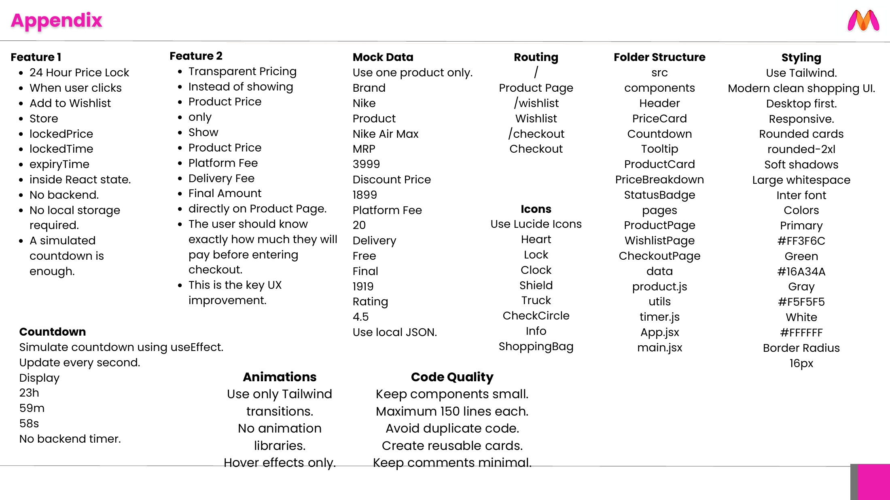

- **Routing:** `/` Product Page · `/wishlist` Wishlist · `/checkout` Checkout
- **Icons (Lucide):** Heart, Lock, Clock, Shield, Truck, CheckCircle, Info, ShoppingBag
- **Countdown:** simulated with `useEffect`, updated every second (e.g., 23h 59m 58s); no backend timer.
- **Animations:** Tailwind transitions and hover effects only; no animation libraries.
- **Code quality:** small components (max 150 lines each), no duplicate code, reusable cards, minimal comments.
- **Styling:** Tailwind, modern clean shopping UI, desktop-first and responsive, rounded cards (`rounded-2xl`), soft shadows, large whitespace, Inter font; colors Primary `#FF3F6C`, Green `#16A34A`, Gray `#F5F5F5`, White `#FFFFFF`; border radius 16px.

---

## 17. Prototype Flow

**Proposed flow:**

`Product Page` → `Add to Wishlist` → `24-Hour Price Lock` → `Wishlist` → `Checkout` → `Locked Price Applied`

| # | Stage | What happens |
|---|---|---|
| 1 | **Product Page** | The user sees the full price breakdown up front: MRP crossed out, discounted price ₹1,899, platform fee ₹20, delivery free, **final payable ₹1,919**, with a "What's Included?" tooltip |
| 2 | **Add to Wishlist** | The user taps Add to Wishlist |
| 3 | **24-Hour Price Lock** | A toast confirms "✅ Price Locked for 24 Hours"; the locked price, lock timestamp and expiry timestamp are stored in React state; the app auto-navigates to the Wishlist |
| 4 | **Wishlist** | The card shows a 🔒 Price Locked badge and a live countdown (e.g., 23h 58m remaining), with **Buy Now** and **Remove** |
| 5 | **Checkout** | Buy Now opens checkout, which inherits the locked price while the countdown is active |
| 6 | **Locked Price Applied** | Order summary: ₹1,899 + ₹20 platform fee + free delivery = **₹1,919**, with the banner "🔒 Locked Price Applied" and a **Proceed to Payment** button (ends the prototype flow) |

**Expired-price scenario:**

1. The simulated timer is forced to expire (a toggle/trigger is built into the prototype for demonstration).
2. A modal blocks checkout, titled **"Price Lock Expired"**, with the message "Your reserved price has expired."
3. The modal shows the **new live market price of ₹2,149** (vs. the locked ₹1,899 + ₹20 platform fee = ₹1,919).
4. The user taps **Continue Shopping**, which resets the prototype.
5. If checkout is reached after expiry, it automatically uses the updated price.

---

## 18. Tech Stack

| Technology | Role |
|---|---|
| **React** | UI framework |
| **Vite** | Build tool / dev environment |
| **React Router** | Client-side routing (`/`, `/wishlist`, `/checkout`) |
| **Tailwind CSS** | Styling and transitions |
| **Lucide React** | Icons |
| **React `useState`** | Local state (locked price, lock/expiry timestamps) |
| **React `useEffect`** | Simulated countdown timer |

**Explicitly excluded by the PRD:** Redux, Context API, Zustand, TypeScript, external UI libraries, Framer Motion and animation packages.

> **This is a UX prototype, not a production e-commerce build.** It uses **no backend, no database, no API (no Firebase or Supabase), no authentication and no payment gateway.** All behavior runs on local React state with mock data, and the project is designed to run on Replit Free.

> The slide for the app version also references Expo Go for mobile preview; the app PRD itself specifies a "Mobile-First Web App (React + Tailwind)". Any other app-specific stack detail is *not specified in the source PDF.*

---

## 19. Project Structure

**Repository layout:**

```text
myntra-product-teardown/
│
├── README.md
├── images/
│   ├── 00-cover.png
│   ├── 01-company-overview.png
│   ├── 02-feature-overview.png
│   ├── 03-primary-research.png
│   ├── 04-secondary-research.png
│   ├── 05-competitive-analysis.png
│   ├── 06-user-persona-ananya.png
│   ├── 07-user-persona-rahul.png
│   ├── 08-user-persona-priya.png
│   ├── 09-user-journey-steps-01-05.png
│   ├── 10-user-journey-steps-06-10.png
│   ├── 11-feature-suggestions.png
│   ├── 12-product-changes.png
│   ├── 13-metrics.png
│   ├── 14-performance-summary.png
│   ├── 15-guesstimate-activation.png
│   ├── 16-guesstimate-gmv-nsm.png
│   ├── 17-detailed-competitive-analysis.png
│   ├── 18-prd-app-overview.png
│   ├── 19-prd-app-scope-requirements.png
│   ├── 20-prd-app-screens-design.png
│   ├── 21-prd-roadmap-web-build.png
│   ├── 22-prd-web-design-reference.png
│   ├── 23-prd-web-features-mockdata.png
│   ├── 24-prd-mvp-scope.png
│   ├── 25-thank-you.png
│   ├── 26-appendix-divider.png
│   └── 27-sources-links.png
│
└── original/
    └── Myntra_Product_Teardown.pdf
```

**Prototype source layout described in the PRD** (the prototype code itself is not part of this repository):

```text
src/
├── components/
│   ├── Header.jsx
│   ├── PriceCard.jsx
│   ├── Countdown.jsx
│   └── Tooltip.jsx
├── pages/
│   ├── ProductPage.jsx
│   ├── WishlistPage.jsx
│   └── CheckoutPage.jsx
├── data/
│   └── product.js
├── App.jsx
└── main.jsx
```

The web PRD additionally lists `ProductCard`, `PriceBreakdown` and `StatusBadge` components and a `utils/timer.js` helper.

---

## 20. Sources

All sources are those listed in the source PDF's appendix.

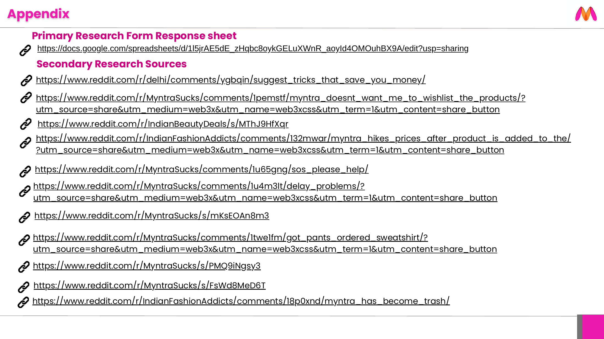

**Primary research**

- Primary research form response sheet: <https://docs.google.com/spreadsheets/d/1l5jrAE5dE_zHqbc8oykGELuXWnR_aoyId4OMOuhBX9A/edit?usp=sharing>

**Company & feature overview**

- <https://inc42.com/company/myntra/>
- <https://www.instagram.com/p/DQ_8uCmjlvY/>

**Secondary research (Reddit)**

1. <https://www.reddit.com/r/delhi/comments/ygbqin/suggest_tricks_that_save_you_money/>
2. <https://www.reddit.com/r/MyntraSucks/comments/1pemstf/myntra_doesnt_want_me_to_wishlist_the_products/?utm_source=share&utm_medium=web3x&utm_name=web3xcss&utm_term=1&utm_content=share_button>
3. <https://www.reddit.com/r/IndianBeautyDeals/s/MThJ9HfXqr>
4. <https://www.reddit.com/r/IndianFashionAddicts/comments/132mwar/myntra_hikes_prices_after_product_is_added_to_the/?utm_source=share&utm_medium=web3x&utm_name=web3xcss&utm_term=1&utm_content=share_button>
5. <https://www.reddit.com/r/MyntraSucks/comments/1u65gng/sos_please_help/>
6. <https://www.reddit.com/r/MyntraSucks/comments/1u4m3lt/delay_problems/?utm_source=share&utm_medium=web3x&utm_name=web3xcss&utm_term=1&utm_content=share_button>
7. <https://www.reddit.com/r/MyntraSucks/s/mKsEOAn8m3>
8. <https://www.reddit.com/r/MyntraSucks/comments/1twe1fm/got_pants_ordered_sweatshirt/?utm_source=share&utm_medium=web3x&utm_name=web3xcss&utm_term=1&utm_content=share_button>
9. <https://www.reddit.com/r/MyntraSucks/s/PMQ9iNgsy3>
10. <https://www.reddit.com/r/MyntraSucks/s/FsWd8MeD6T>
11. <https://www.reddit.com/r/IndianFashionAddicts/comments/18p0xnd/myntra_has_become_trash/>

**Prototype links (from the Change Suggestion slide)**

- Web version: <https://attached-assets--sourav23248.replit.app/>
- App version: <https://price-tracker--sagarfromdtu.replit.app/>

> The PDF does not list a dedicated source for the market-share chart, the competitor UX ratings (9/10, 7/10, 5/10, 8/10) or the guesstimate assumptions (e.g., ₹1,200 per order, 70% retention). *Not specified in the source PDF.*

---

## 21. Conclusion

- **Main problem:** Many Myntra users browse and wishlist but never make a first purchase. Nearly half (48% of the survey) use the wishlist as a price-watch tool, and surprise fees at the final step are the #1 checkout drop-off.
- **Main insight:** The barrier is **price uncertainty and trust**, not a lack of interest. Prices that rise after wishlisting and fees revealed only at checkout feel like a "bait-and-switch." Rigid return penalties and locked refunds deepen the trust gap.
- **Recommended solution:** The **Price Confidence Experience** MVP, combining a **24-Hour Price Lock** with **Transparent All-Inclusive Pricing**, supported by recommended policy changes (transparent pricing, risk-aware returns, original-method refunds).
- **Expected business impact:** First-purchase activation **5% → 7%**, wishlist-to-cart graduation **12% → 15%**, return-to-order ratio held at **30%**, and Net GMV per Active User **₹58.46 → ₹74.59 (+₹16.13)**, a modeled rise in Net Retained GMV from **₹4.385B to ₹5.594B**.

---

## 22. Appendix: All 28 Slides

Every page of the original deck, in original order.

| Page | Slide | Image |
|---|---|---|
| 1 | Cover | [`00-cover.png`](images/00-cover.png) |
| 2 | Company Overview | [`01-company-overview.png`](images/01-company-overview.png) |
| 3 | Feature Overview | [`02-feature-overview.png`](images/02-feature-overview.png) |
| 4 | Primary Research | [`03-primary-research.png`](images/03-primary-research.png) |
| 5 | Secondary Research | [`04-secondary-research.png`](images/04-secondary-research.png) |
| 6 | Competitive Analysis | [`05-competitive-analysis.png`](images/05-competitive-analysis.png) |
| 7 | User Persona 1: Ananya | [`06-user-persona-ananya.png`](images/06-user-persona-ananya.png) |
| 8 | User Persona 2: Rahul | [`07-user-persona-rahul.png`](images/07-user-persona-rahul.png) |
| 9 | User Persona 3: Priya | [`08-user-persona-priya.png`](images/08-user-persona-priya.png) |
| 10 | User Journey, steps 1-5 | [`09-user-journey-steps-01-05.png`](images/09-user-journey-steps-01-05.png) |
| 11 | User Journey, steps 6-10 | [`10-user-journey-steps-06-10.png`](images/10-user-journey-steps-06-10.png) |
| 12 | Feature Suggestion | [`11-feature-suggestions.png`](images/11-feature-suggestions.png) |
| 13 | Change Suggestion | [`12-product-changes.png`](images/12-product-changes.png) |
| 14 | Metrics: NSM and KPIs | [`13-metrics.png`](images/13-metrics.png) |
| 15 | Metrics: Performance Summary | [`14-performance-summary.png`](images/14-performance-summary.png) |
| 16 | Thank You | [`25-thank-you.png`](images/25-thank-you.png) |
| 17 | Appendix Divider | [`26-appendix-divider.png`](images/26-appendix-divider.png) |
| 18 | Appendix: Guesstimate (activation) | [`15-guesstimate-activation.png`](images/15-guesstimate-activation.png) |
| 19 | Appendix: Guesstimate (GMV and NSM) | [`16-guesstimate-gmv-nsm.png`](images/16-guesstimate-gmv-nsm.png) |
| 20 | Appendix: Research Sources | [`27-sources-links.png`](images/27-sources-links.png) |
| 21 | Appendix: Company Sources and Detailed Competitive Analysis | [`17-detailed-competitive-analysis.png`](images/17-detailed-competitive-analysis.png) |
| 22 | Appendix: PRD (App) overview | [`18-prd-app-overview.png`](images/18-prd-app-overview.png) |
| 23 | Appendix: PRD (App) scope and requirements | [`19-prd-app-scope-requirements.png`](images/19-prd-app-scope-requirements.png) |
| 24 | Appendix: PRD (App) screens and design | [`20-prd-app-screens-design.png`](images/20-prd-app-screens-design.png) |
| 25 | Appendix: PRD roadmap and web build | [`21-prd-roadmap-web-build.png`](images/21-prd-roadmap-web-build.png) |
| 26 | Appendix: PRD (Web) design reference | [`22-prd-web-design-reference.png`](images/22-prd-web-design-reference.png) |
| 27 | Appendix: PRD (Web) features and mock data | [`23-prd-web-features-mockdata.png`](images/23-prd-web-features-mockdata.png) |
| 28 | Appendix: MVP scope | [`24-prd-mvp-scope.png`](images/24-prd-mvp-scope.png) |

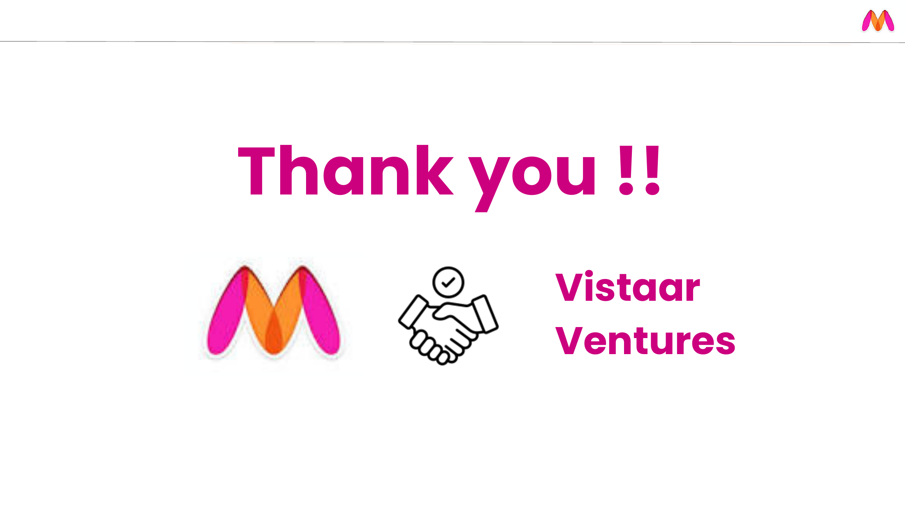

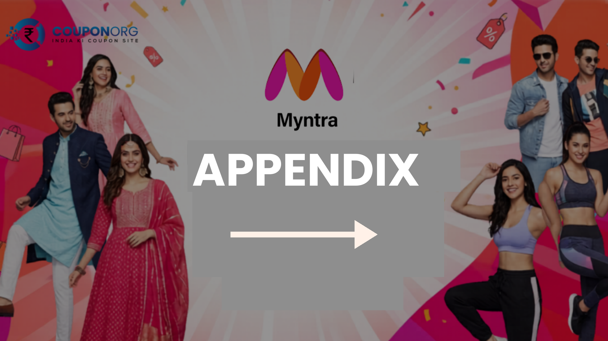

---

<p align="center"><b>Vistaar Ventures</b> · Sagar · Sourav · Priya</p>
